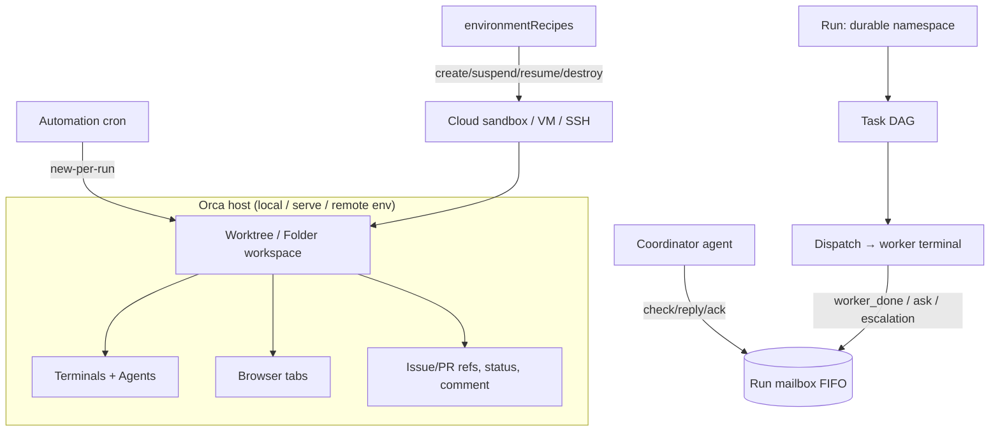

# Research: Tính năng của Orca

**Ngày nghiên cứu:** 2026-10-15
**Nguồn chính:** Orca CLI cài trên máy (`orca`, v1.4.225, `~/.config/orca/cli/bin/orca`), schema `orca agent-context --json` (260 commands), skill guides bundled (`orca skills get`).

## Orca là gì

Orca là nền tảng điều phối coding agent: một runtime (`orca serve`, có thể headless) + desktop app + CLI 260 lệnh. Mô hình lõi: mỗi đơn vị công việc là một **workspace** (worktree git hoặc folder thường), trong đó chứa terminals, browser tabs, metadata liên kết issue/PR. Trên đó xếp các tầng: agent launch, supervised orchestration (Run/Task/Dispatch + mailbox), môi trường remote, browser/computer/emulator automation, automations định kỳ.

## Nhóm tính năng

### 1. Worktree & workspace management

- `worktree create` tạo checkout mới; id dạng `<repoId>::<worktreePath>`. Selector phong phú: `id:`, `name:`, `path:`, `branch:`, `issue:<n>`, `active`/`current`, `folder:<id>` (workspace không cần git).
- Lineage: `--parent-worktree` (worktree/folder cha) hoặc `--no-parent` cho việc độc lập; `--base-branch` chọn git base (mặc định base ref của repo qua `repo set-base-ref`).
- Link issue/review: `--reference <url>` (repeat được, generic), legacy `--pr`, `--issue`, `--linear-issue`, `--gitlab-issue`, `--gitlab-mr`; quản lý sau qua `reference add/remove/list/find`.
- Metadata card: `worktree set --comment`, `--workspace-status todo|in-progress|in-review|completed`, `--unread/--read`.
- `worktree ps` = bảng tổng hợp orchestration gọn qua các worktree.
- Setup hooks per repo: `--setup run|skip|inherit`.
- `repo set --external-worktree-visibility` hiển thị worktree tạo ngoài Orca.

### 2. Agent launch & accounts

- `agent launch` (worktree hiện có) hoặc `worktree create --agent` (checkout mới): `--agent claude|codex|omp|pi|grok|...`, `--prompt`, `--model`, `--effort`.
- Launch outcome là `structured` (chat UI) hoặc `terminal` theo setting Chat UI; receipt nói rõ lý do fallback.
- Retry an toàn: `--retry-launch <operationId>` replay đúng launch đã accept — không duplicate agent hay prompt.
- `account add/list/select/rm`: quản nhiều tài khoản agent trên một host (Claude/Codex/OpenCode/Devin), Codex dùng device-auth → login được từ máy khác.
- `agent hooks on/off`: status hook do Orca quản trong agent CLI.
- `claude-teams`: start Claude Code Agent Teams trong terminal Orca.

### 3. Terminal control

- `terminal create/read/send/wait` với handle runtime-scoped; `wait --for exit|tui-idle` nhận biết agent TUI idle.
- `send` có receipt nhiều stage: `input_accepted` → `turn_started`; `--wait-submit <s>` chờ proof submit, `--retry-request <id>` replay sau lỗi transport mơ hồ — **không resend khi silence**.
- `read` cursor-based paging (`oldestCursor`/`nextCursor`), `split` vertical/horizontal, `close --worktree --all`.
- `terminal-daemon status/restart` cho daemon sống sót qua update.

### 4. Orchestration — tầng supervised đặc trưng nhất

Mô hình ba khái niệm: **Run** (namespace bền + inbox của coordinator, không schedule), **Task** (đơn vị việc, có dependency DAG), **Dispatch** (một attempt có authority duy nhất cho Task).

- Vòng đời coordinator: `run-create` → `worker-start --spec` (tạo Task+Dispatch một lần, đặt worker vào worktree, inject prompt) → `check --wait --types worker_done,escalation,question` → xử lý batch, `reply`, `worker-release/retain` → `check --ack` rồi wait tiếp.
- Mailbox FIFO: `check` trả oldest Delivery, replay cho tới khi `--ack`; `ask` = câu hỏi blocking của worker tới coordinator; `inbox`, `send` (message inter-agent), `gate-create/resolve` (decision gate chặn task).
- Worker lifecycle: `worker-list` (projection liveness `live`/`unverifiable`/`exited` + `attention`/`nextAction` argv), `worker-show/read`, `worker-stop/abandon` (cần positive proof exit), `worker-release/retain`. Nguyên tắc an toàn: **absence ≠ death** — mất liên lạc không cho phép stop/retry/release.
- Dispatch có `--inject` cho terminal tự tạo (unsupervised, chỉ dùng khi `worker-start` không express được).
- Nested workers có depth limit; không reset qua Run mới.
- Harness này có sẵn `xd://orca_mailbox_*` tools bind vào cùng contract — session này có thể đóng vai worker/coordinator native.

### 5. Remote environments & multi-host

- `orca serve`: runtime headless (systemd-style `serve service install`), `environment add --pairing-code` hoặc `ORCA_PAIRING_CODE`/`ORCA_ENVIRONMENT` để CLI nhắm remote.
- Managed server lifecycle: `environment update/rollback/stop/recover/status/cancel-stop/forget`.
- `host list` liệt kê máy target được; `worktree create --host runtime:<env-id>` tạo worktree trên server paired.
- `project setup-clone/setup-existing-folder`: đưa project lên host khác.

### 6. Per-workspace environment recipes (disposable runtime)

Recipe trong `orca.yaml` → `environmentRecipes`: mỗi workspace boot một runtime disposable (Vercel Sandbox, Fly, Modal, SSH host, container local). Hai connection mode: **Orca-server** (create chạy `orca serve` remote, trả `pairingCode`) vs **SSH** (dial trực tiếp).

- Lifecycle scripts: `create` (required, print 1 JSON recipe result), `suspend`/`resume` (stdin lifecycle payload, resume phải re-emit JSON), `destroy` (hoặc `destroy: none`).
- Snapshot 2 tầng: base snapshot (deps + repo + headless build) → auth snapshot (agent CLI đã login qua device-auth). **Không bao giờ snapshot máy đã chạy `orca serve`** — pairing keypair/device registry bị bake chung vào mọi environment boot từ image đó.
- `vm recipe doctor` validate recipe (`--provision` = live test, paid).
- Composer chỉ đọc `environmentRecipes` từ primary checkout — recipe trên branch con không hiện trong "Run on" picker.

### 7. Embedded browser (per-worktree)

Tab browser nhúng scoped theo worktree: `tab create/list/show/switch`, `snapshot` (accessibility tree với ref `e1..en` — ref đổi sau navigation, phải re-snapshot), `click/fill/type/keypress/drag/upload`, `eval` JS, `wait` (element/text/URL/load/JS), `capture start/stop` console+network, `intercept` request, `cookie/storage`, `set device/geolocation/headers/media/offline`, `screenshot/full-screenshot/pdf`.

Browser **profiles** riêng (`tab profile create/clone/set`) → nhiều session login song song trong cùng worktree.

### 8. Computer use & emulators

- `computer *`: điều khiển GUI app window thật (macOS/…) qua accessibility tree — click/type/hotkey/menu/dialog — cho app ngoài hoặc Chrome/Safari external. Chỉ dùng khi không có path programmatic.
- `emulator *`: iOS Simulator và Android (adb) — tap theo normalized coords, gesture, type, hardware button, rotate, install, permissions, logcat; hiển thị live trong pane của Orca.

### 9. Automations (scheduled agent runs)

`automations create --trigger <preset|cron|rrule> --provider <agent> --prompt` — chạy agent định kỳ; `--precheck` gate điều kiện; `--workspace-mode existing|new-per-run` (mỗi lần chạy một worktree mới); `--time/--day/--timezone`; `automations runs` lưu history.

### 10. Artifacts, skills, search, reference

- `artifacts share/update/unshare`: publish HTML/MD ra unlisted link qua tài khoản Orca — **gate ở human** (Settings → Artifacts), CLI không tự bật được.
- `skills share`: publish installed skills ra unlisted link (cũng human-gated); `skills list/get/install/update` bản bundled version-matched.
- `search`: full-text trên agent session history của một host (opt-in ở Settings), trả snippet + `resumeCommand`.
- `reference find <url|STA-1234>`: tìm workspace+agent theo link issue, kèm liveness và mailbox address (`terminal`, `dispatch:<id>`, `run:<id>`).

## Sơ đồ quan hệ

## Liên quan trực tiếp tới vtx

- Worktree Orca chính là bối cảnh của research `worktree-env-loading.md`: Orca-managed worktree cũng là git worktree thường → `.envrc` + direnv hoạt động y hệt; `--setup run` hook của repo là chỗ gọi `direnv allow`/`direnv exec` tự động.
- `environmentRecipes` trả lời bài toán lớn hơn: mỗi workspace có disposable VM → không cần port offset nữa vì mỗi env có localhost riêng.
- Tầng orchestration (Run/Dispatch/mailbox) có thể tận dụng ngay qua `xd://orca_mailbox_*` trong harness hiện tại.

## Câu hỏi còn mở

- User muốn đào sâu hướng nào: dùng Orca để điều phối agent cho vtx, hay tham khảo kiến trúc Orca để xây tính năng tương tự (vtx có `apps/agent-runtime` + Temporal)?
- Giá/licensing của Orca và repo source (nếu public) chưa kiểm tra — CLI local không tiết lộ.
