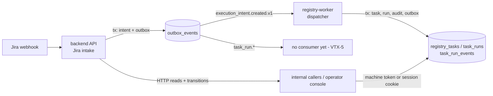
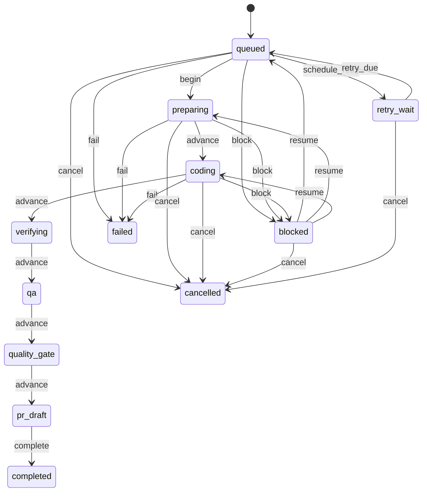

# Runbook — Task Registry & State Machine (VTX-3)

Operational guide for the registry: state machine, outbox dispatcher, DLQ,
backfill, and the two Phase-1 metric queries. Scope is VTX-3; VTX-2 (Jira
webhook intake) is documented in `docs/runbooks/jira-webhook-intake.md`.

## 1. Process map



`registry-worker` runs `worker registry`: it opens PostgreSQL and never dials
Temporal, so a Temporal outage cannot stop registry intake (D8/TR-08).

## 2. State machine



**Phase-1 operational subset.** Only `block`, `resume`, `schedule_retry`,
`retry_due`, `cancel`, `fail` (and `begin` from `queued`) have a runtime path.
The pipeline hops (`advance`, and `complete` from `quality_gate`/`pr_draft`)
are present in the contract but return **409 `stage_not_operational`**: their
downstream systems (VTX-4 coding, VTX-5 orchestration, VTX-7 gates, VTX-13 PR)
do not exist yet. This is deliberate — the registry refuses rather than
forging completion evidence. `commit_sha` stays NULL in Phase 1 by design.

Terminal states: `completed`, `failed`, `cancelled`. `blocked` and `retry_wait`
are non-terminal by contract.

## 3. Delivery contract (outbox)

- **One consumer identity**: `registry-intake` (`REGISTRY_CONSUMER_NAME`), shared
  by all dispatcher replicas. N replicas are safe: the claim uses
  `FOR UPDATE SKIP LOCKED`.
- **At-least-once delivery, exactly-once persisted effect.** The effect
  (`ConsumeIntent`) commits in its own transaction; `published_at` is stamped
  afterwards. A crash in between replays the event, and the `inbox_consumptions`
  receipt makes the replay a no-op.
- **Routing guard**: the dispatcher claims only `execution_intent.created.v1`,
  so registry-emitted `task_run.*` events can never feed back into intake.
- `task_run.*` events stay `published_at IS NULL` until VTX-5 exists. That is the
  intended signal, not a stuck queue.

### Run states

`queued → preparing → coding → verifying → qa → quality_gate → pr_draft → completed`,
with `blocked`, `retry_wait`, `failed`, `cancelled` reachable per §2.

## 4. Operational queries

Active runs by state (also the Phase-1 "runs in flight" metric):

```sql
SELECT state, count(*) AS run_count
FROM task_runs
WHERE state NOT IN ('completed', 'failed', 'cancelled')
GROUP BY state
ORDER BY state;
```

Outbox lag for the registry consumer (pending count + age of the oldest):

```sql
SELECT count(*), min(created_at)
FROM outbox_events
WHERE published_at IS NULL
  AND dead_lettered_at IS NULL
  AND event_type = 'execution_intent.created.v1';
```

> Every "is there work left?" query **must** carry `AND dead_lettered_at IS NULL`.
> Without it, dead-lettered rows look like a permanent backlog.

Dead-letter queue inspection:

```sql
SELECT outbox_id, event_type, attempt, dead_letter_reason, created_at
FROM outbox_events
WHERE dead_lettered_at IS NOT NULL
ORDER BY dead_lettered_at DESC;
```

Deferred intents (FIFO queue awaiting a free task; VTX-5 drains it):

```sql
SELECT intent_id, task_id, received_at, reason
FROM deferred_intents
WHERE disposition = 'pending_deferred'
ORDER BY received_at, intent_id;
```

## 5. Redrive a dead-lettered event

Poison events (malformed payload, unknown required field, missing
`execution_intents` row) are dead-lettered with a reason instead of retried
forever. Transient failures retry with bounded exponential backoff + jitter up
to `MaxAttempts`, then dead-letter.

```sql
UPDATE outbox_events
SET dead_lettered_at = NULL,
    dead_letter_reason = NULL,
    attempt = 0,
    next_attempt_at = NULL
WHERE outbox_id = '<outbox_id>';
```

Redrive only after fixing the cause (repair the payload or insert the missing
intent). A redriven event that is still poison dead-letters again — that is the
loop guard, not a failure.

## 6. Backfill

There is no separate backfill job. **Enabling `registry-worker` is the
backfill**: `published_at IS NULL AND dead_lettered_at IS NULL` is the
checkpoint, so every intent that VTX-2 committed while the dispatcher was down
is picked up on start. Verify with the lag query in §4 before and after.

## 7. Restart / crash behaviour

| Symptom | Meaning | Action |
|---|---|---|
| Dispatcher restarts repeatedly | DB unreachable or bad DSN | Check `DATABASE_URL`; the process exits on `Ping` failure |
| Events pending, nothing published | All replicas down | `docker compose up -d registry-worker` |
| One event stuck at high `attempt` | Transient failure repeating | Inspect `dead_letter_reason`, then §5 |
| `task_run.*` pending forever | Expected in Phase 1 | No action until VTX-5 exists |
| Temporal down, registry still consuming | Expected (D8) | No action |

Claim leases (`claimed_until`) expire after 30s, so a `SIGKILL`ed replica's
in-flight events are reclaimed by a sibling automatically.

## 8. HTTP API

Base path `/api/v1/registry`. A machine caller authenticates with **one of
three actor tokens**; the token determines the actor, and the request body can
never set it. A human operator signs in at `POST /api/v1/auth/login` and uses
the resulting `vtx_session` cookie; the session maps to the `operator` actor.

| Method | Path | Purpose |
|---|---|---|
| GET | `/api/v1/registry/tasks/{site_id}/{issue_id}` | Task by Jira identity |
| GET | `/api/v1/registry/runs/{run_id}` | One run |
| GET | `/api/v1/registry/runs/{run_id}/events` | Audit trail (cursor `after_version`) |
| POST | `/api/v1/registry/runs/{run_id}/transitions` | The only mutation path |

Errors: `404 not_found`; `409 stale_version | stale_lease | already_terminal |
invalid_transition | conflict_active_run | stage_not_operational`; `403 forbidden`
(token's actor may not perform the action, or the body claimed another actor).
Nothing is written when a conflict is returned.

**No public ingress.** The production gateway proxies only the Jira webhook
path; the prod overlay publishes no backend port. Phase-1 callers are internal
processes on the compose/k8s network (the VTX-5 scheduler later).

### Actor credentials

`REGISTRY_ACTOR_SCHEDULER_TOKEN`, `REGISTRY_ACTOR_ORCHESTRATOR_TOKEN`, and
`REGISTRY_ACTOR_POLICY_TOKEN` are required by `cmd/api` (`ValidateRegistry`
fails closed), must differ from each other, and must differ from
`GATEWAY_INTERNAL_AUTH_TOKEN`. These are `system` actors.

The human operator no longer has a bearer token. Seed the single account with
`make user-password` (or `worker user set-password`) and sign in through the
console. Sessions are opaque 32-byte tokens stored as SHA-256 hashes in
`auth_sessions`, expire after `SESSION_TTL` (default 30 days), and slide at
most once per hour. A password change revokes every other session.

The registry E2E harness logs in with the account it seeds, then sends the
session cookie on the transition calls — the same path an operator uses.

## 9. Known Phase-1 limits

- **No lease-granting API.** `begin` (and the other lease-guarded actions)
  require a live `lease_epoch`/`lease_owner`, but nothing in Phase 1 issues a
  lease — VTX-5 owns that. Until then, the lease path is proven by SQL-level
  integration tests, not by an operator workflow.
- **No downstream consumer** for `task_run.*` events (VTX-5).
- **No Prometheus exporter.** Metrics are the two SQL queries in §4; adding an
  exporter later is additive.
- Pipeline stages past `queued` are contract-only (`stage_not_operational`).

## 10. Verification

```bash
# Unit + integration (needs a throwaway DB)
TEST_DATABASE_URL=... make test-integration

# E2E: 2 replicas, SIGKILL replay, DLQ + redrive, routing guard, backfill,
# secret hygiene, metric queries. The harness seeds its own operator account
# and logs in before the transition calls.
./infra/scripts/test-registry-outbox.sh | tee registry-evidence.log
```
